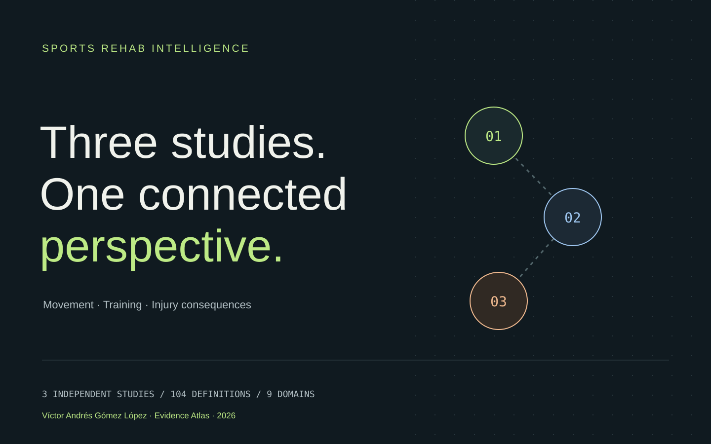

# Sports Rehab Intelligence

**Three studies. One connected perspective.**  
Sports Rehabilitation & Human Performance · Víctor Andrés Gómez López · Research release 1.0.0

[Interactive ES/EN atlas](https://sports-rehab-intelligence.vercel.app) · [Evidence](https://sports-rehab-intelligence.vercel.app/evidence.html) · [Kaggle dataset](https://www.kaggle.com/datasets/vctorandrsgmezlpez/sports-rehab-intelligence-evidence-atlas) · [Kaggle audit notebook](https://www.kaggle.com/code/vctorandrsgmezlpez/sports-rehab-three-study-evidence-audit) · [Portfolio](https://victor-gomez-portfolio.vercel.app/projects/sports-rehab-intelligence)



## The research direction

**Which movement, training and injury-consequence dimensions are observed, and which measurements and validations are needed to connect them?**

This project brings three independent studies together as a reproducible **evidence and data-compatibility atlas**. It integrates source-aware definitions, outcomes, measurement coverage and aggregate findings. People, sports, time bases and endpoints retain their context. No athlete linkage, pooled injury count, combined clinical score or multimodal effect estimate is produced.

| Study | Contribution | Reviewed evidence and limits |
| --- | --- | --- |
| [Running Injury Clinic](https://running-injury-clinic.vercel.app) · [code](https://github.com/victorgomezadapty/running-injury-clinic) | Movement and current-status metadata | 1,402 people with running metadata; 30-person pilot, 13 variables per side; local official event/cycle validation pending |
| [Competitive Runners](https://competitive-runners-injury-risk.vercel.app) · [code](https://github.com/victorgomezadapty/competitive-runners-injury-risk) | Training histories and selected injury labels | 74 athletes, 42,766 Day events, 583 retained labels; saved temporal/athlete validation; future-conditioned controls |
| [European Football Injuries](https://european-football-injuries.vercel.app) · [code](https://github.com/victorgomezadapty/european-football-injuries) | Recorded absence and consequences | 15,603 records; duration, match loss and repeated-interval sensitivity; no complete eligible-exposure denominator or verified clinical return |

The framework **movement → training → injury → consequences** describes research questions, not an observed causal chain across these cohorts.

## What is implemented

- A common catalogue of **104 source-prefixed definitions**, preserving original metadata, units, timing and limitations. These are not 104 simultaneously measured predictors.
- A registry of **three distinct outcomes**, and an authored compatibility map of **nine domains × three sources**.
- Contextual views of RIC pilot medians/quartiles, primary held-out runners metrics and football burden/sensitivity. Numerical results remain attributed to the source analyses.
- Eleven aggregate/definition inputs frozen to source Git commits, SHA-256 provenance, a self-contained Kaggle package and an independently executable offline audit notebook.
- A responsive bilingual static website, conceptual SVGs, searchable catalogue, matching chart tables, reduced-motion support and a motion pause control.
- Prominent source-specific conclusions, a joint interpretation of what the integration produced, and an interactive educational runner separating illustrative poses from real pilot medians. See the [Spanish synthesis](docs/synthesis_es.md).
- A bilingual focused discussion and a specification for a future genuinely linked cohort.

## Reproduce offline

Python 3.11+ uses the standard library only. Node 20+ builds the website without npm dependencies. No sibling folders, raw participant data, network calls or accounts are required to reproduce the committed release.

```powershell
python scripts/build_release.py
python -m unittest discover -s tests -v
npm test
npm run build
npm run dev
```

Open the local URL printed by the dev server. The notebook at `notebooks/01_evidence_atlas_audit.ipynb` runs beside the release files or with the Kaggle dataset attached. The test suite executes its code cells in a fresh namespace without requiring a Jupyter installation.

## Files

```text
config/                   Construct map and primary references
data/source-snapshots/    Aggregate/definition inputs only
data/source_manifest.json  Repository, exact commit, paths and checksums
scripts/                  Offline compilation, notebook and static build
reports/                  Source summary and lossless definition catalogue
delivery/kaggle/          Rebuilt dataset release
delivery/kaggle-notebook/ Notebook and platform metadata
notebooks/                Standalone release and source audit
docs/                     Methods, discussion, search record and research plan
web/                      Bilingual atlas and licensed downloads
tests/                    Evidence, provenance, endpoint and web contracts
```

## Qué reúne este proyecto

Sports Rehab Intelligence es el proyecto integrador de tres estudios sobre **movimiento, entrenamiento y consecuencias de la lesión**. Su primera entrega compara qué está medido, qué es provisional y qué datos faltan. El catálogo conserva la fuente de cada definición y los resultados mantienen sus denominadores.

La siguiente etapa empírica necesita las mismas personas con identidad estable, biomecánica validada, historia temporal, episodios clínicos y exposición elegible. Una fuente no completa retrospectivamente las mediciones ausentes de otra cohorte. Lee la [discusión en español](docs/discussion_es.md), los [métodos](docs/methodology.md) y la [línea de investigación](docs/research_direction.md).

## Attribution and rights

Original measurements: **Ferber, Brett, Fukuchi, Hettinga and Osis**, RIC Figshare v1, [DOI](https://doi.org/10.25452/figshare.plus.24255795.v1), CC BY 4.0; **Sofie Lövdal, Ruud J. R. den Hartigh and George Azzopardi**, Dataverse v2.0, [DOI](https://doi.org/10.34894/UWU9PV), CC0; **Sanan Muzaffarov**, European Football Injuries Kaggle v2, [source](https://www.kaggle.com/datasets/sananmuzaffarov/european-football-injuries-2020-2025/versions/2), CC BY-SA 4.0. Cite creators separately from this independent analysis.

Original software: [MIT](LICENSE). Atlas compilation and derivatives: **CC BY-SA 4.0**, with separately identifiable source rights preserved. See [attribution, transformations and licences](DATA_LICENSE.md). No raw trajectories, individual training histories, named medical histories, full articles or third-party figures are redistributed. The narrative discussion is not a systematic review.
